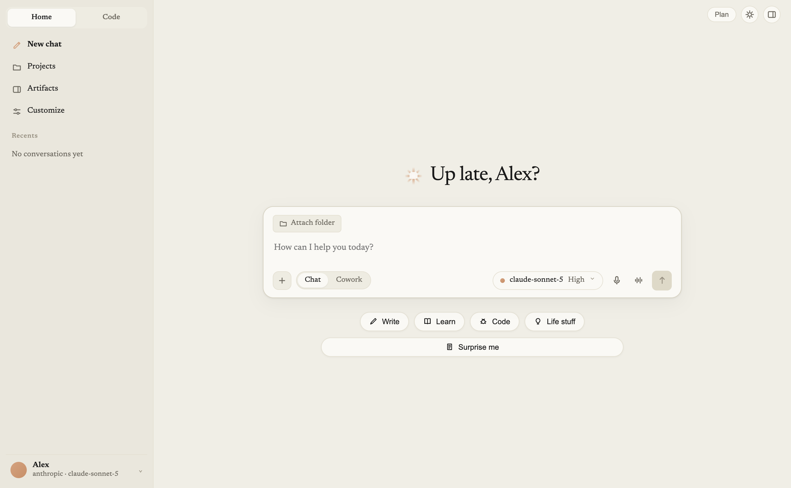
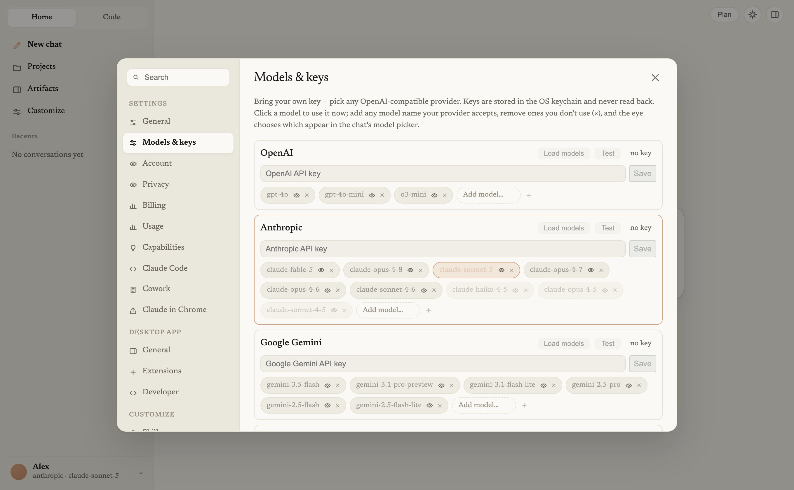

# VersoWork

**VersoWork** is an open-source, **model-agnostic (BYOK & local-LLM)** native desktop workspace for chat, live sandboxed artifacts, MCP tools, and jailed agentic coding.

[](https://github.com/mlubbad/versowork/actions/workflows/ci.yml)
[](https://github.com/mlubbad/versowork/releases)
[](LICENSE)
[](backend/pyproject.toml)
[](desktop/src-tauri)

> **Why VersoWork?** In bookmaking, *recto and verso* are the two facing pages of a folio: **conversational reasoning on the left, live interactive Artifacts and your local code repository on the right**, turning freely across **15+ cloud and local model providers** with your keys stored in your OS keychain and your data on your own machine.



---

## Highlights

- **15+ Cloud & Local Providers Out of the Box:** Switch mid-conversation between **Anthropic** (native Messages API adapter with extended-thinking signature caching and prompt cache breakpoints), **Google Gemini**, **Vertex AI** (GCP ADC auto-refresh), **OpenAI**, **NVIDIA NIM**, **DeepSeek**, **Qwen**, **Zhipu GLM**, **Groq**, **Mistral**, **OpenRouter**, **Together AI**, and zero-key local **Ollama**, **vLLM**, **LM Studio**, and **`llama.cpp`** (plus any custom OpenAI-compatible URL).
- **Lightweight Native Tauri v2 Shell (macOS, Windows, Linux):** Ships as a self-contained native app (`~40 MB` WebView RAM footprint vs bloated Electron wrappers) bundling a PyInstaller-frozen FastAPI sidecar (`127.0.0.1:18410`) and a pinned Node runtime for zero-setup `.mcpb` extensions.
- **Agentic Coding Harness (`Code` Mode):** Attach any local git repository or folder and get symlink-safe jailed file tools (`read_file`, `edit_file`, `write_file`, `glob`, `grep`), curated workspace `bash` test/build runners, per-turn file checkpoints with **one-click Rewind**, `.claude/settings.json` rule compatibility (`default`, `acceptEdits`, `plan`, `strict`, `bypass`), and **5-event programmable lifecycle hooks** (`SessionStart`, `UserPromptSubmit`, `PreToolUse`, `PostToolUse`, `Stop`).
- **Gen-2 Live Artifacts & Office File Creation:** Stream interactive HTML, React/JSX, SVG, Mermaid, CSV, and Markdown previews inside isolated `sandbox="allow-scripts"` iframes, and generate downloadable `.xlsx`, `.docx`, `.pptx`, and `.pdf` documents.
- **MCP, One-Click `.mcpb` Bundles, `/skill-builder` & Cowork:** Connect `stdio` and Streamable HTTP MCP servers (including OAuth 2.0 + PKCE), author reusable skills conversationally via `/skill-builder`, run background Cowork tasks, or drive the exact same engine from your terminal via `verso`.
- **100% Open Typography & Multilingual RTL/BiDi:** Bundled SIL Open Font License 1.1 `Newsreader` + `Noto Naskh Arabic` + `Noto Serif` with automatic per-paragraph BiDi directionality and isolated LTR code blocks.



---

## Quick Start

### Option 1: Download Prebuilt Desktop App
Grab the latest native installer for **macOS (`.dmg`)**, **Windows (`.msi` / `.exe`)**, or **Linux (`.AppImage` / `.deb`)** from [**GitHub Releases**](https://github.com/mlubbad/versowork/releases).

*(macOS unsigned community build note: if Gatekeeper prompts on first open, run `xattr -cr /Applications/VersoWork.app` once.)*

### Option 2: Run from Source (60 Seconds)

```bash
git clone https://github.com/mlubbad/versowork.git
cd versowork

# 1. Install the Python 3.12+ engine & `verso` CLI
python3.12 -m venv .venv && source .venv/bin/activate   # Windows: .venv\Scripts\activate
pip install -e "./backend[dev]"
cp .env.example .env                                    # optional: or add keys in Settings -> Models & keys

# Try the terminal client immediately (e.g. against local Ollama or any configured provider)
verso -p "Summarize the security boundaries in backend/ocd_core/harness/ in 4 bullets."
```

To run the full desktop UI during development:

```bash
# Terminal 1: FastAPI + SSE engine on loopback :8000
uvicorn app.main:app --app-dir backend --reload

# Terminal 2: React 18 + Vite UI on http://localhost:1420 (proxies /api -> :8000)
cd desktop && npm install && npm run dev
```

*(To open inside the native Rust Tauri v2 window instead of a browser tab, run `cd desktop && npm run tauri dev`.)*

---

## Supported Providers

| Category | Built-in Providers | Auth & Storage |
| :--- | :--- | :--- |
| **Local (Zero Key)** | Ollama (`:11434`), vLLM (`:8000`), LM Studio (`:1234`), `llama.cpp` (`:8080`) | No key required; 100% offline capable |
| **Native Adapters** | Anthropic Messages API (Claude 4.5 / 4.6 / 5 extended thinking + prompt cache), Google Vertex AI | OS Keychain (`keyring`) or GCP ADC auto-refresh |
| **Hosted BYOK** | Google Gemini, OpenAI, NVIDIA NIM, DeepSeek, Qwen (DashScope), Zhipu GLM, Groq, Mistral, OpenRouter, Together AI, Custom OpenAI URL | OS Keychain (`keyring`, encrypted Fernet fallback on headless Linux) |

---

## Architecture & Security Posture

| Path | Responsibility |
| :--- | :--- |
| `backend/ocd_core/` | Framework-agnostic core: agent loop, provider adapters, jailed coding harness, lifecycle hooks, MCP registry & OAuth, ChromaDB RAG, Cowork, scheduler, keychain secrets |
| `backend/app/` | FastAPI HTTP + SSE surface protected by loopback-only default bind, `TrustedHostMiddleware` (anti-DNS-rebinding), and per-launch 64-hex `X-OCD-Token` |
| `backend/ocd_cli/` | Terminal client (`verso` / `ocd`) sharing 100% of `ocd_core` |
| `desktop/` | React 18 + TypeScript + Vite UI and Tauri v2 Rust shell (`desktop/src-tauri/`) |
| `content/marketplace/` | Bundled offline-ready plugin catalog |

Key local-first defenses enforced by **1,570+ automated unit and contract tests**:
- **Loopback + Per-Launch Shared Secret:** Packaged sidecar binds `127.0.0.1:18410` and requires the per-launch `X-OCD-Token` minted by the Rust shell, blocking drive-by browser requests.
- **Symlink-Safe Workspace Jail:** `resolve_in_workspace()` resolves symlinks and rejects parent traversals, sibling-prefix escapes, and overwrites of unread files.
- **Fail-Closed Lifecycle Hooks & Sandboxed Code Execution:** `PreToolUse` hooks receive tool JSON over `stdin` (never shell-interpolated) with secrets stripped and fail closed on timeout or malformed output; `code_execution` runs inside `docker --network none`.
- **Isolated Artifact Previews & SSRF Guards:** Artifacts execute inside `sandbox="allow-scripts"` without `allow-same-origin`; `web_fetch` and REST/MCP connectors block RFC1918/link-local metadata targets.

---

## Testing & Contributing

```bash
pytest backend/tests                                      # 1,160+ backend & security tests
ruff check .                                              # Python linter
cd desktop && npm run typecheck && npm test && npm run build  # 410+ UI & layout contract tests
```

Contributions, provider presets, MCP integrations, and bug reports are very welcome! Check [`CONTRIBUTING.md`](CONTRIBUTING.md), [`CODE_OF_CONDUCT.md`](CODE_OF_CONDUCT.md), and open [`good first issue`](https://github.com/mlubbad/versowork/labels/good%20first%20issue) tickets.

---

## License & Trademark Notice

Released under the [MIT License](LICENSE). Bundled typefaces (`Newsreader`, `Noto Naskh Arabic`, `Noto Serif`) are licensed under the [SIL Open Font License 1.1](desktop/src/assets/fonts/OFL.txt).

*VersoWork is an independent open-source project created by [Dr. Mohammed Lubbad](https://github.com/mlubbad) and contributors, inspired by modern editorial desktop AI workspaces. It is not affiliated with, endorsed by, or sponsored by Anthropic PBC, OpenAI, Google, or any other model provider. "Claude" and other provider names are trademarks of their respective owners and are referenced solely to describe API and configuration compatibility.*
